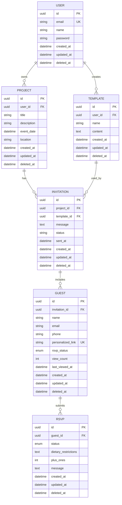

# Momentscape Database ERD

## Relationships

- A `User` can own many `Projects` and create many `Templates`.
- A `Project` can have many `Invitations`.
- An `Invitation` may use one `Template`.
- An `Invitation` includes many `Guests`.
- A `Guest` can submit multiple `RSVPs` over time.

## Indexes

- `users.email`
- `users.deleted_at`
- `projects.user_id`, `projects.deleted_at`
- `templates.user_id`, `templates.deleted_at`
- `invitations.project_id`, `invitations.template_id`, `invitations.deleted_at`
- `guests.invitation_id`, `guests.email`, `guests.personalized_link`, `guests.rsvp_status`, `guests.deleted_at`
- `rsvps.guest_id`, `rsvps.status`, `rsvps.deleted_at`

## Soft Deletes

All models include a `deleted_at` timestamp. Records with a non-null `deleted_at` are considered deleted.
